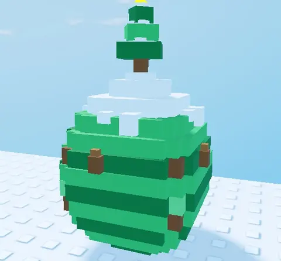

# Œuf Pine (Shovel for Eggs)

Pine Egg — zone **Pine Forest**. Œuf en blocs à studs (tranches empilées, dessus Studs, dessous Inlet) : zigzag vert de sapin, pommes de pin sur les côtés, neige qui coule de la calotte, mini sapin enneigé avec étoile au sommet.

- **Catégorie** : [Bibliothèque 3D](../Biblioth%C3%A8que%203D.md)
- **Sous-catégorie** : [Hiver - Shovel for Eggs](Hiver%20-%20Shovel%20for%20Eggs%20%28Biblioth%C3%A8que%203D%29.md)
- **Type** : Modèle en Parts
- **Taille** : 4 × 8 × 4 studs
- **Contenu** : 116 Parts
- **Pivot** : centre de la boîte englobante, posé au sol
- **Fichier source** : `Assets/models/ShovelForEggs/ShovelForEggs_Egg_Pine.rbxm` (dans le vault)
- **Pack complet** : [Œufs à studs (Shovel for Eggs)](%C5%92ufs%20%C3%A0%20studs%20%28Shovel%20for%20Eggs%29.md)
