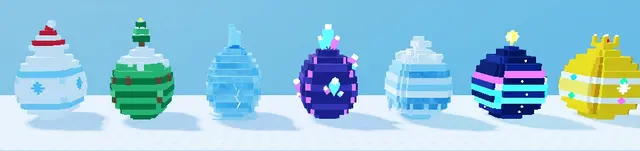

# Œufs à studs (Shovel for Eggs)

Les 7 œufs du jeu en blocs à studs : chaque œuf est fait de tranches empilées (dessus à studs, dessous Inlet), avec un motif et un décor liés à sa zone de la montagne.

| Œuf | Zone | Décor |
| --- | --- | --- |
| Snow | Snowy Village | rayures bleu glace, flocons, bonnet de Noël rayé à pompon |
| Pine | Pine Forest | zigzag de sapin, pommes de pin, coulures de neige, mini sapin enneigé |
| Frozen | Frozen Lake | coquille de glace translucide, fissures, flocons gravés, éclats, flaque gelée |
| Crystal | Ice Cave | roche violette, grappes de cristaux néon, lueur + étincelles |
| Glacier | Glacier Summit | strates de glacier, ceinture de stalactites, calotte de neige |
| Aurora | Aurora Peak | nuit étoilée, rubans d'aurore néon, étoile au sommet, lueur |
| Golden | Tempête dorée | or, bandes à gemmes, flocons dorés, couronne, étincelles |

- **Catégorie** : [Bibliothèque 3D](../Biblioth%C3%A8que%203D.md)
- **Sous-catégorie** : [Hiver - Shovel for Eggs](Hiver%20-%20Shovel%20for%20Eggs%20%28Biblioth%C3%A8que%203D%29.md)
- **Type** : Pack de modèles en Parts
- **Taille** : 4 × 6 à 8 × 4 studs (par œuf, décor compris)
- **Contenu** : 7 modèles · 110 à 130 Parts chacun
- **Pivot** : centre de la boîte englobante, posé au sol (les scripts du jeu remettent l'œuf à l'échelle)
- **Fichier source** : `Assets/models/ShovelForEggs/ShovelForEggs_StudEggs.rbxm` (dans le vault)
- **Créé pour** : Shovel for Eggs (remplace les œufs lisses des biomes), script de génération `tools/build_eggs.lua`
