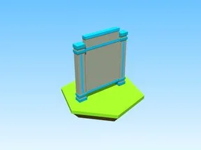

# Code Goals Board · Robot Simulator

Modèle en Parts « Code Goals Board » (Robot Simulator).

- **Catégorie** : [Bibliothèque 3D](../Biblioth%C3%A8que%203D.md)
- **Sous-catégorie** : [Leaderboards & panneaux](Leaderboards%20&%20panneaux%20%28Biblioth%C3%A8que%203D%29.md)
- **Type** : Modèle en Parts
- **Taille** : 2 × 12 × 10 studs
- **Contenu** : 20 Parts · 9 MeshParts
- **Jeu d'origine** : Robot Simulator
- **Fichier source** : `Assets/models/ByType/Leaderboards_Boards/RobotSim_CodeGoalsBoard.rbxm` (dans le vault)
