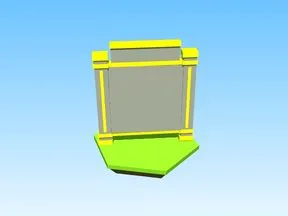

# Coins Board · Robot Simulator

Modèle en Parts « Coins Board » (Robot Simulator).

- **Catégorie** : [Bibliothèque 3D](../Biblioth%C3%A8que%203D.md)
- **Sous-catégorie** : [Leaderboards & panneaux](Leaderboards%20&%20panneaux%20%28Biblioth%C3%A8que%203D%29.md)
- **Type** : Modèle en Parts
- **Taille** : 9 × 16 × 9 studs
- **Contenu** : 20 Parts · 5 MeshParts
- **Jeu d'origine** : Robot Simulator
- **Fichier source** : `models/ByType/Leaderboards_Boards/RobotSim_CoinsBoard.rbxm` (dans ta bibliothèque `rblx\lib`)
