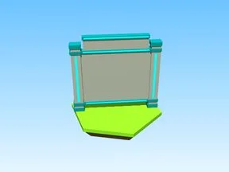

# Gamepass Board · Robot Simulator

Modèle en Parts « Gamepass Board » (Robot Simulator).

- **Catégorie** : [Bibliothèque 3D](../Biblioth%C3%A8que%203D.md)
- **Sous-catégorie** : [Leaderboards & panneaux](Leaderboards%20%26%20panneaux%20%28Biblioth%C3%A8que%203D%29.md)
- **Type** : Modèle en Parts
- **Taille** : 13 × 18 × 13 studs
- **Contenu** : 20 Parts · 8 MeshParts
- **Jeu d'origine** : Robot Simulator
- **Fichier source** : `models/ByType/Leaderboards_Boards/RobotSim_GamepassBoard.rbxm` (dans ta bibliothèque `rblx\lib`)
