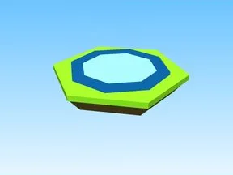

# Index · Tapping Lords

Modèle en Parts « Index » (Tapping Lords).

- **Catégorie** : [Bibliothèque 3D](../Biblioth%C3%A8que%203D.md)
- **Sous-catégorie** : [Leaderboards & panneaux](Leaderboards%20%26%20panneaux%20%28Biblioth%C3%A8que%203D%29.md)
- **Type** : Modèle en Parts
- **Taille** : 11 × 1 × 10 studs
- **Contenu** : 10 Parts
- **Jeu d'origine** : Tapping Lords
- **Fichier source** : `models/ByType/Leaderboards_Boards/TappingLords_Index.rbxm` (dans ta bibliothèque `rblx\lib`)
