# Leaderboards & panneaux

Sous-catégorie de [Bibliothèque 3D](../Biblioth%C3%A8que%203D.md) · **28 éléments**

| Aperçu | Élément | Infos |
| --- | --- | --- |
| 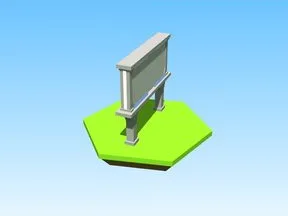 | [Billboard · Robot Simulator](Billboard%20%C2%B7%20Robot%20Simulator.md) | Modèle en Parts · 10 × 31 × 33 · 28 Parts |
| 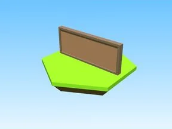 | [Billboard · Shoot A Brainrot](Billboard%20%C2%B7%20Shoot%20A%20Brainrot.md) | Modèle en Parts · 43 × 16 × 1 · 5 Parts |
| 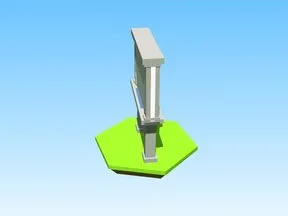 | [Billboard Square · Robot Simulator](Billboard%20Square%20%C2%B7%20Robot%20Simulator.md) | Modèle en Parts · 17 × 31 × 16 · 26 Parts |
| 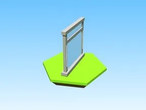 | [Boss · Robot Simulator](Boss%20%C2%B7%20Robot%20Simulator%20%C2%B7%20Leaderboards%20&%20panneaux.md) | Modèle en Parts · 3 × 10 × 9 · 9 Parts · 9 MeshParts |
| 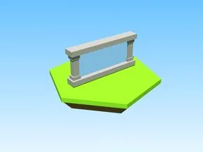 | [Capture Sign · Robot Simulator](Capture%20Sign%20%C2%B7%20Robot%20Simulator.md) | Modèle en Parts · 2 × 4 × 9 · 12 Parts |
|  | [Code Goals Board · Robot Simulator](Code%20Goals%20Board%20%C2%B7%20Robot%20Simulator.md) | Modèle en Parts · 2 × 12 × 10 · 20 Parts · 9 MeshParts |
| 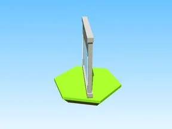 | [Cog · Robot Simulator](Cog%20%C2%B7%20Robot%20Simulator.md) | Modèle en Parts · 7 × 10 × 7 · 9 Parts · 9 MeshParts |
|  | [Coins Board · Robot Simulator](Coins%20Board%20%C2%B7%20Robot%20Simulator.md) | Modèle en Parts · 9 × 16 × 9 · 20 Parts · 5 MeshParts |
| 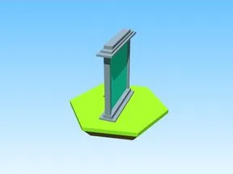 | [Dev Product Sign · Tweeting Simulator](Dev%20Product%20Sign%20%C2%B7%20Tweeting%20Simulator.md) | Modèle en Parts · 3 × 11 × 9 · 8 Parts |
| 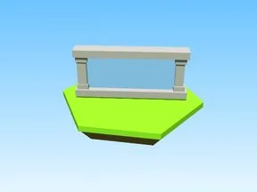 | [Dungeon Sign · Robot Simulator](Dungeon%20Sign%20%C2%B7%20Robot%20Simulator.md) | Modèle en Parts · 8 × 4 × 6 · 12 Parts · 6 MeshParts |
| 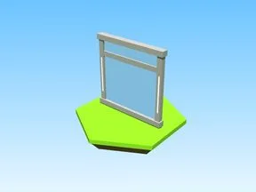 | [Egg Hatched · Robot Simulator](Egg%20Hatched%20%C2%B7%20Robot%20Simulator.md) | Modèle en Parts · 10 × 10 × 1 · 9 Parts · 11 MeshParts |
|  | [Gamepass Board · Robot Simulator](Gamepass%20Board%20%C2%B7%20Robot%20Simulator.md) | Modèle en Parts · 13 × 18 × 13 · 20 Parts · 8 MeshParts |
| 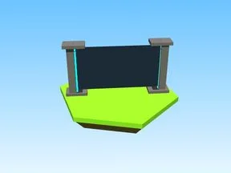 | [Gamepass Sign · Robot Simulator](Gamepass%20Sign%20%C2%B7%20Robot%20Simulator.md) | Modèle en Parts · 8 × 7 × 8 · 13 Parts |
| 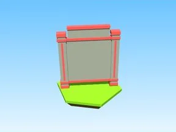 | [Gems Board · Robot Simulator](Gems%20Board%20%C2%B7%20Robot%20Simulator.md) | Modèle en Parts · 10 × 16 × 9 · 20 Parts · 4 MeshParts |
| 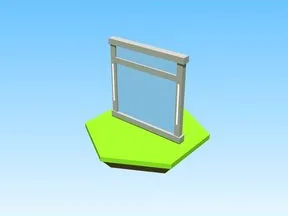 | [Hill · Robot Simulator](Hill%20%C2%B7%20Robot%20Simulator.md) | Modèle en Parts · 10 × 10 × 1 · 9 Parts · 9 MeshParts |
|  | [Index · Tapping Lords](Index%20%C2%B7%20Tapping%20Lords%20%C2%B7%20Leaderboards%20&%20panneaux.md) | Modèle en Parts · 11 × 1 × 10 · 10 Parts |
| 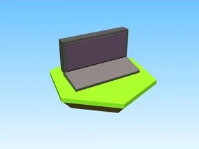 | [Laptop Sign · Tweeting Simulator](Laptop%20Sign%20%C2%B7%20Tweeting%20Simulator.md) | Modèle en Parts · 2 × 4 × 1 · 3 Parts · 3 MeshParts |
| 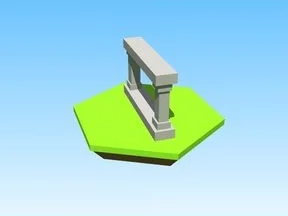 | [Leaderboard Update Model · Robot Simulator](Leaderboard%20Update%20Model%20%C2%B7%20Robot%20Simulator.md) | Modèle en Parts · 6 × 4 × 4 · 8 Parts |
| 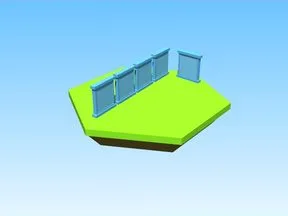 | [Leaderboards · Tapping Lords](Leaderboards%20%C2%B7%20Tapping%20Lords.md) | Modèle en Parts · 15 × 11 × 48 · 35 Parts |
| 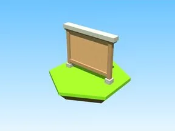 | [Plaques · Pet Pharmica](Plaques%20%C2%B7%20Pet%20Pharmica.md) | Modèle en Parts · 13 × 11 × 1 · 8 Parts |
| 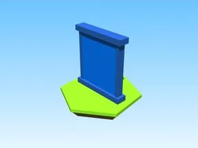 | [Rankboard · Tapping Lords](Rankboard%20%C2%B7%20Tapping%20Lords.md) | Modèle en Parts · 12 × 14 × 1 · 7 Parts |
| 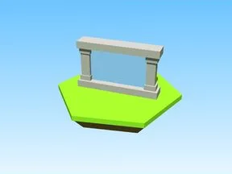 | [Shirt Sign · Robot Simulator](Shirt%20Sign%20%C2%B7%20Robot%20Simulator.md) | Modèle en Parts · 6 × 4 × 2 · 9 Parts |
| 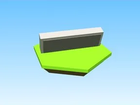 | [Special Sign · Tweeting Simulator](Special%20Sign%20%C2%B7%20Tweeting%20Simulator.md) | Modèle en Parts · 1 × 1 × 1 · 2 Parts · 3 MeshParts |
| 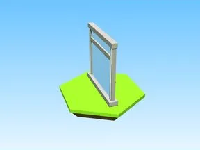 | [Time · Robot Simulator](Time%20%C2%B7%20Robot%20Simulator.md) | Modèle en Parts · 8 × 10 × 5 · 9 Parts · 10 MeshParts |
| 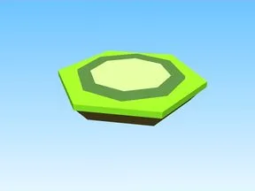 | [Titles · Tapping Lords](Titles%20%C2%B7%20Tapping%20Lords%20%C2%B7%20Leaderboards%20&%20panneaux.md) | Modèle en Parts · 10 × 1 × 10 · 10 Parts |
| 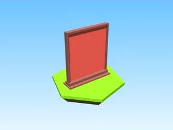 | [Total Tweets · Tweeting Simulator](Total%20Tweets%20%C2%B7%20Tweeting%20Simulator.md) | Modèle en Parts · 2 × 11 × 9 · 6 Parts |
| 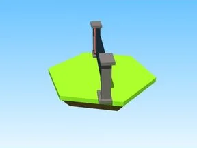 | [Tycoon Sign · Robot Simulator](Tycoon%20Sign%20%C2%B7%20Robot%20Simulator.md) | Modèle en Parts · 38 × 20 × 38 · 13 Parts · 7 MeshParts |
| 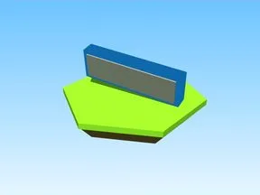 | [Verified Sign · Tweeting Simulator](Verified%20Sign%20%C2%B7%20Tweeting%20Simulator.md) | Modèle en Parts · 1 × 1 × 1 · 2 Parts · 3 MeshParts |
