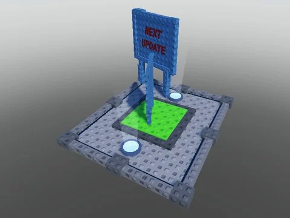

# Panneau « Next Update »

Panneau « Next Update » : plateforme, panneaux en bois et bouton Purchase.

- **Catégorie** : [Bibliothèque 3D](../Biblioth%C3%A8que%203D.md)
- **Sous-catégorie** : [Leaderboards & panneaux](Leaderboards%20&%20panneaux%20%28Biblioth%C3%A8que%203D%29.md)
- **Type** : Modèle Roblox (.rbxm)
- **Contenu** : 1 fichier · 18 Ko
- **Fichier source** : `Assets/models/ByType/Leaderboards_Boards/NEXT UPDATE.rbxm` (dans le vault)
