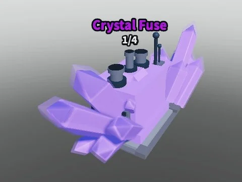

# Crystal Fuse

Machine de fusion thème cristal (modèle Normal : porte, console, cristaux, cheminée, écran, overhead).

- **Catégorie** : [Bibliothèque 3D](../Biblioth%C3%A8que%203D.md)
- **Sous-catégorie** : [Machines](Machines%20%28Biblioth%C3%A8que%203D%29.md)
- **Type** : Modèle Roblox (.rbxm)
- **Contenu** : 1 fichier · 35 Ko
- **Fichier source** : `Assets/models/ByType/Machines_Upgraders/Crystal Fuse.rbxm` (dans le vault)
