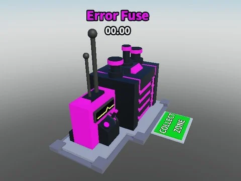

# Error Fuse

Machine de fusion « Error » (FuseMachine : zones Spawn/Collect, console, écran, cheminée, antenne, modèles).

- **Catégorie** : [Bibliothèque 3D](../Biblioth%C3%A8que%203D.md)
- **Sous-catégorie** : [Machines](Machines%20%28Biblioth%C3%A8que%203D%29.md)
- **Type** : Modèle Roblox (.rbxm)
- **Contenu** : 1 fichier · 47 Ko
- **Fichier source** : `Assets/models/ByType/Machines_Upgraders/Error Fuse.rbxm` (dans le vault)
