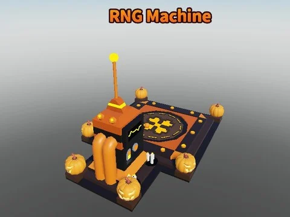

# Machines

Sous-catégorie de [Bibliothèque 3D](../Biblioth%C3%A8que%203D.md) · **19 éléments**

| Aperçu | Élément | Infos |
| --- | --- | --- |
|  | [Shelves Model · Bakery Simulator](Shelves%20Model%20%C2%B7%20Bakery%20Simulator.md) | Modèle en Parts · 12 × 3 × 4 · 13 Parts · 5 MeshParts |
|  | [Shelves Model 2 · Bakery Simulator](Shelves%20Model%202%20%C2%B7%20Bakery%20Simulator.md) | Modèle en Parts · 12 × 3 × 4 · 13 Parts · 6 MeshParts |
|  | [Shelves Model 3 · Bakery Simulator](Shelves%20Model%203%20%C2%B7%20Bakery%20Simulator.md) | Modèle en Parts · 12 × 3 × 4 · 13 Parts · 9 MeshParts |
|  | [Shelves Model 6 · Bakery Simulator](Shelves%20Model%206%20%C2%B7%20Bakery%20Simulator.md) | Modèle en Parts · 12 × 3 × 1 · 11 Parts |
|  | [Shelves Model 7 · Bakery Simulator](Shelves%20Model%207%20%C2%B7%20Bakery%20Simulator.md) | Modèle en Parts · 13 × 4 × 2 · 20 Parts |
|  | [Machines & upgraders — pack par type (66 modèles)](Machines%20&%20upgraders%20%E2%80%94%20pack%20par%20type%20%2866%20mod%C3%A8les%29.md) | Pack de fichiers · 66 fichiers · 4,9 Mo |
|  | [Upgrade Machine](Upgrade%20Machine.md) | Pack de fichiers · 1 fichier · 95 Ko |
|  | [Bee Craft Machine](Bee%20Craft%20Machine.md) | Modèle Roblox (.rbxm) · 1 fichier · 44 Ko |
|  | [Crystal Fuse](Crystal%20Fuse.md) | Modèle Roblox (.rbxm) · 1 fichier · 35 Ko |
|  | [Error Fuse](Error%20Fuse.md) | Modèle Roblox (.rbxm) · 1 fichier · 47 Ko |
|  | [Halloween RNG Machine (by Jibxy)](Halloween%20RNG%20Machine%20%28by%20Jibxy%29.md) | Modèle Roblox (.rbxm) · 1 fichier · 80 Ko |
|  | [Neon Wheel / Cyber Spin Wheel (legamer)](Neon%20Wheel%20%20Cyber%20Spin%20Wheel%20%28legamer%29.md) | Modèle Roblox (.rbxm) · 1 fichier · 25 Ko |
|  | [Stock (taco truck, by Willy)](Stock%20%28taco%20truck,%20by%20Willy%29.md) | Modèle Roblox (.rbxm) · 1 fichier · 34 Ko |
|  | [Phantom Craft (crédit lenny)](Phantom%20Craft%20%28cr%C3%A9dit%20lenny%29.md) | Modèle Roblox (.rbxm) · 1 fichier · 38 Ko |
|  | [Strawberry Fuse 🧀](Strawberry%20Fuse%20%F0%9F%A7%80.md) | Modèle Roblox (.rbxm) · 1 fichier · 32 Ko |
|  | [Treadmills (tapis de course)](Treadmills%20%28tapis%20de%20course%29.md) | Modèle Roblox (.rbxm) · 1 fichier · 35 Ko |
|  | [Tredmills (6 tapis de course)](Tredmills%20%286%20tapis%20de%20course%29.md) | Modèle Roblox (.rbxm) · 1 fichier · 11 Ko |
|  | [Volcan Fuse (VOLCCAN FUSE)](Volcan%20Fuse%20%28VOLCCAN%20FUSE%29.md) | Modèle Roblox (.rbxm) · 1 fichier · 0,2 Mo |
|  | [modelz (RNG Machine + Beehive)](modelz%20%28RNG%20Machine%20+%20Beehive%29.md) | Pack de fichiers · 3 fichiers · 0,1 Mo |
