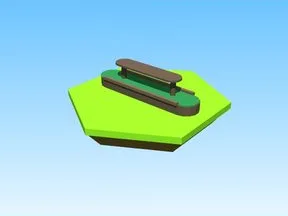
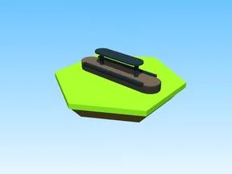

# Machines

Sous-catégorie de [Bibliothèque 3D](../Biblioth%C3%A8que%203D.md) · **5 éléments**

| Aperçu | Élément | Infos |
| --- | --- | --- |
|  | [Shelves Model · Bakery Simulator](Shelves%20Model%20%C2%B7%20Bakery%20Simulator.md) | Modèle en Parts · 12 × 3 × 4 · 13 Parts · 5 MeshParts |
|  | [Shelves Model 2 · Bakery Simulator](Shelves%20Model%202%20%C2%B7%20Bakery%20Simulator.md) | Modèle en Parts · 12 × 3 × 4 · 13 Parts · 6 MeshParts |
|  | [Shelves Model 3 · Bakery Simulator](Shelves%20Model%203%20%C2%B7%20Bakery%20Simulator.md) | Modèle en Parts · 12 × 3 × 4 · 13 Parts · 9 MeshParts |
|  | [Shelves Model 6 · Bakery Simulator](Shelves%20Model%206%20%C2%B7%20Bakery%20Simulator.md) | Modèle en Parts · 12 × 3 × 1 · 11 Parts |
|  | [Shelves Model 7 · Bakery Simulator](Shelves%20Model%207%20%C2%B7%20Bakery%20Simulator.md) | Modèle en Parts · 13 × 4 × 2 · 20 Parts |
