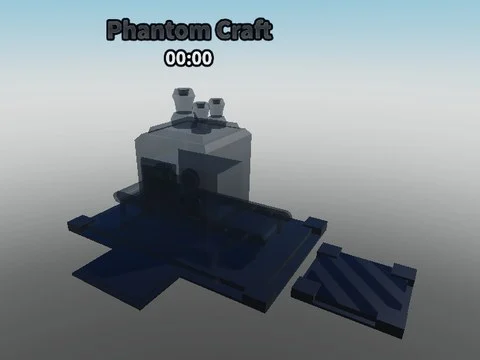

# Phantom Craft (crédit lenny)

Machine de craft « Phantom » (crédit lenny) : pads, charge pad, hitboxes, VFX, zones Spawn/Collect, 36 scripts.

- **Catégorie** : [Bibliothèque 3D](../Biblioth%C3%A8que%203D.md)
- **Sous-catégorie** : [Machines](Machines%20%28Biblioth%C3%A8que%203D%29.md)
- **Type** : Modèle Roblox (.rbxm)
- **Contenu** : 1 fichier · 38 Ko
- **Fichier source** : `Assets/models/ByType/Machines_Upgraders/Phantom Craft (credit lenny).rbxm` (dans le vault)
