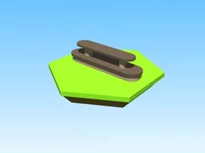

# Shelves Model 6 · Bakery Simulator

Modèle en Parts « Shelves Model 6 » (Bakery Simulator).

- **Catégorie** : [Bibliothèque 3D](../Biblioth%C3%A8que%203D.md)
- **Sous-catégorie** : [Machines](Machines%20%28Biblioth%C3%A8que%203D%29.md)
- **Type** : Modèle en Parts
- **Taille** : 12 × 3 × 1 studs
- **Contenu** : 11 Parts
- **Jeu d'origine** : Bakery Simulator
- **Fichier source** : `models/ByType/Machines_Upgraders/BakerySim_Shelves_Model_6.rbxm` (dans ta bibliothèque `rblx\lib`)
