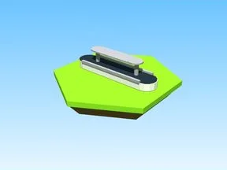

# Shelves Model · Bakery Simulator

Modèle en Parts « Shelves Model » (Bakery Simulator).

- **Catégorie** : [Bibliothèque 3D](../Biblioth%C3%A8que%203D.md)
- **Sous-catégorie** : [Machines](Machines%20%28Biblioth%C3%A8que%203D%29.md)
- **Type** : Modèle en Parts
- **Taille** : 12 × 3 × 4 studs
- **Contenu** : 13 Parts · 5 MeshParts
- **Jeu d'origine** : Bakery Simulator
- **Fichier source** : `Assets/models/ByType/Machines_Upgraders/BakerySim_Shelves_Model.rbxm` (dans le vault)
