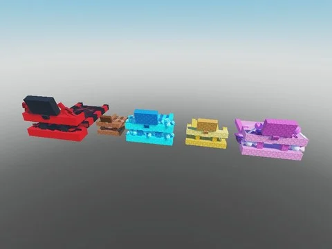

# Treadmills (tapis de course)

Dossier de tapis de course (Treadmill, TreadmillAdmin, TreadmillDiamond…) ; aucun script.

- **Catégorie** : [Bibliothèque 3D](../Biblioth%C3%A8que%203D.md)
- **Sous-catégorie** : [Machines](Machines%20%28Biblioth%C3%A8que%203D%29.md)
- **Type** : Modèle Roblox (.rbxm)
- **Contenu** : 1 fichier · 35 Ko
- **Fichier source** : `Assets/models/ByType/Machines_Upgraders/Treadmills.rbxm` (dans le vault)
