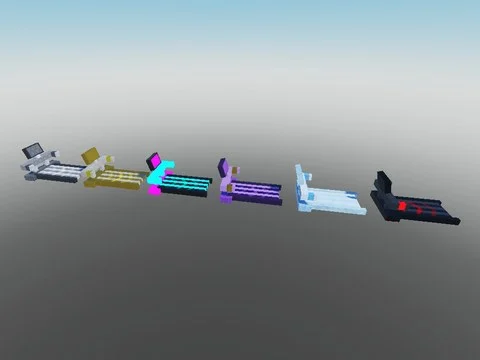

# Tredmills (6 tapis de course)

6 tapis de course (Tredmill1 à Tredmill6) ; aucun script.

- **Catégorie** : [Bibliothèque 3D](../Biblioth%C3%A8que%203D.md)
- **Sous-catégorie** : [Machines](Machines%20%28Biblioth%C3%A8que%203D%29.md)
- **Type** : Modèle Roblox (.rbxm)
- **Contenu** : 1 fichier · 11 Ko
- **Fichier source** : `Assets/models/ByType/Machines_Upgraders/Tredmills.rbxm` (dans le vault)
