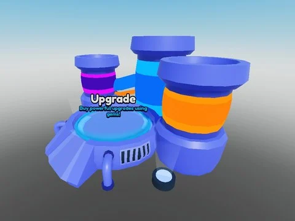

# Upgrade Machine

Machine d’amélioration (23 MeshParts, beams, lumières au sol, panneau Upgrades). 71 instances, aucun script.

- **Catégorie** : [Bibliothèque 3D](../Biblioth%C3%A8que%203D.md)
- **Sous-catégorie** : [Machines](Machines%20%28Biblioth%C3%A8que%203D%29.md)
- **Type** : Pack de fichiers
- **Contenu** : 1 fichier · 95 Ko
- **Fichier source** : `Assets/models/Machines/UpgradeMachine.rbxm` (dans le vault)
