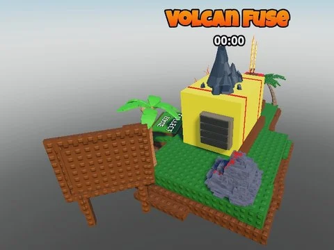

# Volcan Fuse (VOLCCAN FUSE)

Machine de fusion thème volcan (FuseMachine : volcan, palmiers, boutons, VFX, pathfinding) avec 69 scripts.

- **Catégorie** : [Bibliothèque 3D](../Biblioth%C3%A8que%203D.md)
- **Sous-catégorie** : [Machines](Machines%20%28Biblioth%C3%A8que%203D%29.md)
- **Type** : Modèle Roblox (.rbxm)
- **Contenu** : 1 fichier · 0,2 Mo
- **Fichier source** : `Assets/models/ByType/Machines_Upgraders/VOLCCAN FUSE.rbxm` (dans le vault)
