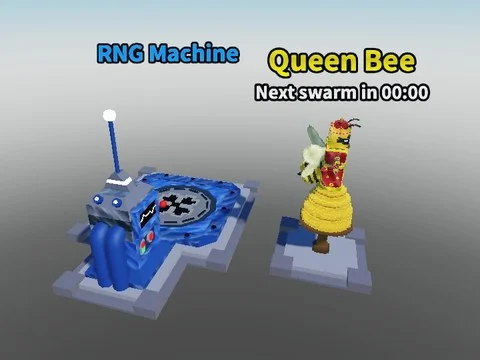

# modelz (RNG Machine + Beehive)

2 modèles : RNGMachine (machine avec pad, prompt, overhead) et Beehive (ruche avec QueenBrainrot et VFX).

- **Catégorie** : [Bibliothèque 3D](../Biblioth%C3%A8que%203D.md)
- **Sous-catégorie** : [Machines](Machines%20%28Biblioth%C3%A8que%203D%29.md)
- **Type** : Pack de fichiers
- **Contenu** : 3 fichiers · 0,1 Mo
- **Fichier source** : `Assets/packs/modelz` (dans le vault)

## Fichiers (3)

- `modelz.rbxm`
- `Beehive.rbxm`
- `RNGMachine.rbxm`
