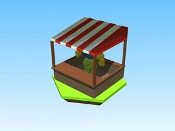

# Gears · +1 Health Every Second

Modèle en Parts « Gears » (+1 Health Every Second).

- **Catégorie** : [Bibliothèque 3D](../Biblioth%C3%A8que%203D.md)
- **Sous-catégorie** : [Maps & îles](Maps%20&%20%C3%AEles%20%28Biblioth%C3%A8que%203D%29.md)
- **Type** : Modèle en Parts
- **Taille** : 12 × 11 × 10 studs
- **Contenu** : 105 Parts · 40 MeshParts
- **Jeu d'origine** : +1 Health Every Second
- **Fichier source** : `Assets/models/ByType/Maps_Islands_Worlds/1HealthEverySecond_Gears.rbxm` (dans le vault)
