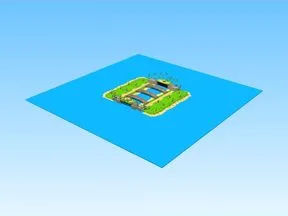

# Map · Shoot A Brainrot

Modèle en Parts « Map » (Shoot A Brainrot).

- **Catégorie** : [Bibliothèque 3D](../Biblioth%C3%A8que%203D.md)
- **Sous-catégorie** : [Maps & îles](Maps%20&%20%C3%AEles%20%28Biblioth%C3%A8que%203D%29.md)
- **Type** : Modèle en Parts
- **Taille** : 420 × 75 × 430 studs
- **Contenu** : 3 720 Parts · 100 MeshParts
- **Jeu d'origine** : Shoot A Brainrot
- **Fichier source** : `Assets/models/ByType/Maps_Islands_Worlds/ShootABrainrot_Map.rbxm` (dans le vault)
