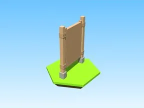
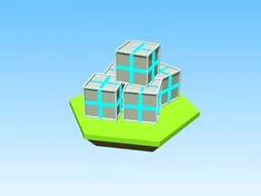
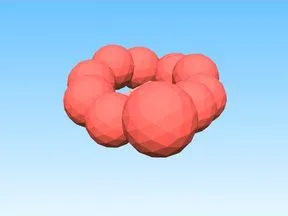
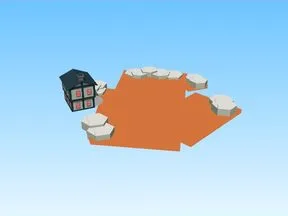
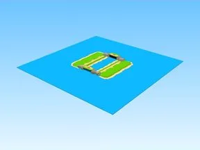
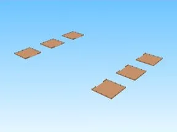
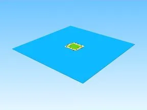
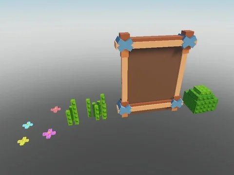

# Maps & îles

Sous-catégorie de [Bibliothèque 3D](../Biblioth%C3%A8que%203D.md) · **12 éléments**

| Aperçu | Élément | Infos |
| --- | --- | --- |
|  | [1Spawn Model · Pet Pharmica](1Spawn%20Model%20%C2%B7%20Pet%20Pharmica%20%C2%B7%20Maps%20&%20%C3%AEles.md) | Modèle en Parts · 3 × 15 × 13 · 50 Parts · 20 MeshParts |
|  | [Boxes · Robot Simulator](Boxes%20%C2%B7%20Robot%20Simulator.md) | Modèle en Parts · 11 × 8 × 13 · 85 Parts |
|  | [Candy Land 2 · Tweeting Simulator](Candy%20Land%202%20%C2%B7%20Tweeting%20Simulator.md) | Modèle en Parts · 621 × 73 × 672 · 15 Parts · 113 MeshParts |
|  | [Garbage Land · Tweeting Simulator](Garbage%20Land%20%C2%B7%20Tweeting%20Simulator.md) | Modèle en Parts · 401 × 51 × 357 · 55 Parts · 23 MeshParts |
|  | [Gears · +1 Health Every Second](Gears%20%C2%B7%20+1%20Health%20Every%20Second.md) | Modèle en Parts · 12 × 11 × 10 · 105 Parts · 40 MeshParts |
|  | [Island3 2 · Robot Simulator](Island3%202%20%C2%B7%20Robot%20Simulator.md) | Modèle en Parts · 130 × 37 × 143 · 281 Parts · 28 MeshParts |
|  | [Map · Shoot A Brainrot](Map%20%C2%B7%20Shoot%20A%20Brainrot.md) | Modèle en Parts · 420 × 75 × 430 · 3 720 Parts · 100 MeshParts |
|  | [Others · Shoot A Brainrot](Others%20%C2%B7%20Shoot%20A%20Brainrot.md) | Modèle en Parts · 420 × 31 × 368 · 669 Parts |
|  | [Plots · Shoot A Brainrot](Plots%20%C2%B7%20Shoot%20A%20Brainrot.md) | Modèle en Parts · 322 × 3 × 231 · 186 Parts |
|  | [Template Island](Template%20Island.md) | Modèle en Parts · 393 × 29 × 359 · 992 Parts · 6 MeshParts |
|  | [Maps, îles & mondes — pack par type (47 modèles)](Maps,%20%C3%AEles%20&%20mondes%20%E2%80%94%20pack%20par%20type%20%2847%20mod%C3%A8les%29.md) | Pack de fichiers · 47 fichiers · 10,3 Mo |
|  | [Studio Market Pack (Hexagons Pack)](Studio%20Market%20Pack%20%28Hexagons%20Pack%29.md) | Pack de fichiers · 11 fichiers · 0,1 Mo |
