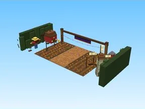

# B1 Pumpkin Farm

Modèle en Parts « B1 Pumpkin Farm ».

- **Catégorie** : [Bibliothèque 3D](../Biblioth%C3%A8que%203D.md)
- **Sous-catégorie** : [Maps Spooky](Maps%20Spooky.md)
- **Type** : Modèle en Parts
- **Taille** : 190 × 47 × 92 studs
- **Contenu** : 6 556 Parts
- **Fichier source** : `maps/SpookyBiomes/B1_PumpkinFarm.rbxm` (dans ta bibliothèque `rblx\lib`)
