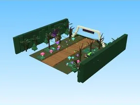

# B4 Witch Swamp

Modèle en Parts « B4 Witch Swamp ».

- **Catégorie** : [Bibliothèque 3D](../Biblioth%C3%A8que%203D.md)
- **Sous-catégorie** : [Maps Spooky](Maps%20Spooky.md)
- **Type** : Modèle en Parts
- **Taille** : 193 × 41 × 183 studs
- **Contenu** : 959 Parts
- **Fichier source** : `Assets/maps/SpookyBiomes/B4_WitchSwamp.rbxm` (dans le vault)
