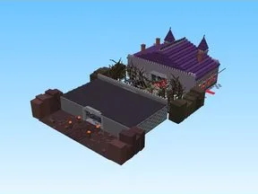

# B5 Vampire Castle

Modèle en Parts « B5 Vampire Castle ».

- **Catégorie** : [Bibliothèque 3D](../Biblioth%C3%A8que%203D.md)
- **Sous-catégorie** : [Maps Spooky](Maps%20Spooky.md)
- **Type** : Modèle en Parts
- **Taille** : 220 × 107 × 383 studs
- **Contenu** : 5 074 Parts
- **Fichier source** : `maps/SpookyBiomes/B5_VampireCastle.rbxm` (dans ta bibliothèque `rblx\lib`)
