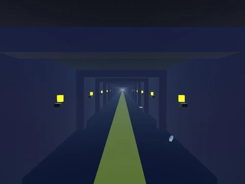

# Maps Spooky — compléments (3)

Maps de Steal an Spooky Egg pas encore dans le vault : B0_Lobby, FondNuit, VIP_Catacombs.

- **Catégorie** : [Bibliothèque 3D](../Biblioth%C3%A8que%203D.md)
- **Sous-catégorie** : [Maps Spooky](Maps%20Spooky.md)
- **Type** : Pack de fichiers
- **Contenu** : 3 fichiers · 0,2 Mo
- **Jeu d'origine** : Steal an Spooky Egg
- **Fichier source** : `Assets/maps/SpookyBiomes` (dans le vault)

## Fichiers (3)

- `B0_Lobby.rbxm`
- `FondNuit.rbxm`
- `VIP_Catacombs.rbxm`
