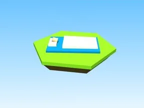

# Builders Simple Bed · Robot Simulator

Modèle en Parts « Builders Simple Bed » (Robot Simulator).

- **Catégorie** : [Bibliothèque 3D](../Biblioth%C3%A8que%203D.md)
- **Sous-catégorie** : [PNJ & personnages](PNJ%20%26%20personnages%20%28Biblioth%C3%A8que%203D%29.md)
- **Type** : Modèle en Parts
- **Taille** : 5 × 1 × 4 studs
- **Contenu** : 4 Parts · 15 MeshParts
- **Jeu d'origine** : Robot Simulator
- **Fichier source** : `models/ByType/NPC_Characters/RobotSim_BuildersSimpleBed.rbxm` (dans ta bibliothèque `rblx\lib`)
