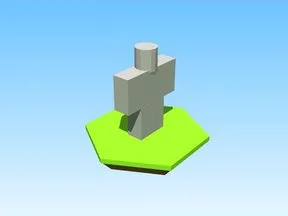

# Dummy · Pet Pharmica

Modèle en Parts « Dummy » (Pet Pharmica).

- **Catégorie** : [Bibliothèque 3D](../Biblioth%C3%A8que%203D.md)
- **Sous-catégorie** : [PNJ & personnages](PNJ%20%26%20personnages%20%28Biblioth%C3%A8que%203D%29.md)
- **Type** : Modèle en Parts
- **Taille** : 1 × 4 × 3 studs
- **Contenu** : 7 Parts
- **Jeu d'origine** : Pet Pharmica
- **Fichier source** : `models/ByType/NPC_Characters/PetPharmica_Dummy.rbxm` (dans ta bibliothèque `rblx\lib`)
