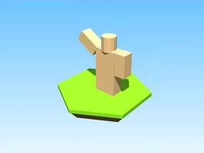

# Get Dressedforthe Beach · Billionaire Tycoon

Modèle en Parts « Get Dressedforthe Beach » (Billionaire Tycoon).

- **Catégorie** : [Bibliothèque 3D](../Biblioth%C3%A8que%203D.md)
- **Sous-catégorie** : [PNJ & personnages](PNJ%20&%20personnages%20%28Biblioth%C3%A8que%203D%29.md)
- **Type** : Modèle en Parts
- **Taille** : 3 × 4 × 1 studs
- **Contenu** : 6 Parts · 1 MeshPart
- **Jeu d'origine** : Billionaire Tycoon
- **Fichier source** : `models/ByType/NPC_Characters/BillionaireTycoon_GetDressedfortheBeach.rbxm` (dans ta bibliothèque `rblx\lib`)
