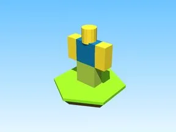

# Noob · Shoot A Brainrot

Modèle en Parts « Noob » (Shoot A Brainrot).

- **Catégorie** : [Bibliothèque 3D](../Biblioth%C3%A8que%203D.md)
- **Sous-catégorie** : [PNJ & personnages](PNJ%20&%20personnages%20%28Biblioth%C3%A8que%203D%29.md)
- **Type** : Modèle en Parts
- **Taille** : 4 × 5 × 1 studs
- **Contenu** : 6 Parts
- **Jeu d'origine** : Shoot A Brainrot
- **Fichier source** : `Assets/models/ByType/NPC_Characters/ShootABrainrot_Noob.rbxm` (dans le vault)
