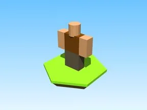
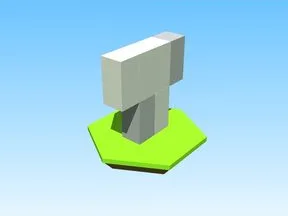
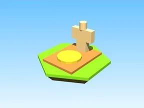

# PNJ & personnages

Sous-catégorie de [Bibliothèque 3D](../Biblioth%C3%A8que%203D.md) · **19 éléments**

| Aperçu | Élément | Infos |
| --- | --- | --- |
|  | [Basic Dude · Shoot A Brainrot](Basic%20Dude%20%C2%B7%20Shoot%20A%20Brainrot.md) | Modèle en Parts · 4 × 5 × 1 · 6 Parts |
|  | [Bonus Idle For Robot · Robot Simulator](Bonus%20Idle%20For%20Robot%20%C2%B7%20Robot%20Simulator.md) | Modèle en Parts · 1 × 4 × 3 · 7 Parts |
|  | [Builders Simple Bed · Robot Simulator](Builders%20Simple%20Bed%20%C2%B7%20Robot%20Simulator.md) | Modèle en Parts · 5 × 1 × 4 · 4 Parts · 15 MeshParts |
|  | [Dummy · Pet Pharmica](Dummy%20%C2%B7%20Pet%20Pharmica.md) | Modèle en Parts · 1 × 4 × 3 · 7 Parts |
|  | [Get Dressedforthe Beach · Billionaire Tycoon](Get%20Dressedforthe%20Beach%20%C2%B7%20Billionaire%20Tycoon.md) | Modèle en Parts · 3 × 4 × 1 · 6 Parts · 1 MeshPart |
|  | [Giorno · Cashgrab Bridge](Giorno%20%C2%B7%20Cashgrab%20Bridge.md) | Modèle en Parts · 3 × 4 × 3 · 8 Parts · 3 MeshParts |
|  | [Gunner · Robot Simulator](Gunner%20%C2%B7%20Robot%20Simulator.md) | Modèle en Parts · 1 × 4 × 1 · 6 Parts · 4 MeshParts |
|  | [Noob · Shoot A Brainrot](Noob%20%C2%B7%20Shoot%20A%20Brainrot.md) | Modèle en Parts · 4 × 5 × 1 · 6 Parts |
|  | [Npc · Shoot A Brainrot](Npc%20%C2%B7%20Shoot%20A%20Brainrot.md) | Modèle en Parts · 3 × 4 × 1 · 6 Parts |
|  | [Npc 2 · Shoot A Brainrot](Npc%202%20%C2%B7%20Shoot%20A%20Brainrot.md) | Modèle en Parts · 3 × 4 × 1 · 6 Parts · 1 MeshPart |
|  | [Pharmox · Pet Pharmica](Pharmox%20%C2%B7%20Pet%20Pharmica.md) | Modèle en Parts · 2 × 3 × 3 · 6 Parts · 1 MeshPart |
|  | [Rich · Cashgrab Bridge](Rich%20%C2%B7%20Cashgrab%20Bridge.md) | Modèle en Parts · 4 × 4 × 3 · 8 Parts · 5 MeshParts |
|  | [Robot · Robot Simulator](Robot%20%C2%B7%20Robot%20Simulator.md) | Modèle en Parts · 1 × 11 × 17 · 5 Parts · 1 MeshPart |
|  | [Robot Sell NPC · Robot Simulator](Robot%20Sell%20NPC%20%C2%B7%20Robot%20Simulator.md) | Modèle en Parts · 2 × 3 × 3 · 5 Parts · 1 MeshPart |
|  | [Robotby Onscurezynkez · Robot Simulator](Robotby%20Onscurezynkez%20%C2%B7%20Robot%20Simulator.md) | Modèle en Parts · 20 × 44 × 40 · 122 Parts · 2 MeshParts |
|  | [Stomp · Robot Simulator](Stomp%20%C2%B7%20Robot%20Simulator.md) | Modèle en Parts · 1 × 12 × 18 · 5 Parts · 1 MeshPart |
|  | [Tung Tung Sahur · Shoot A Brainrot](Tung%20Tung%20Sahur%20%C2%B7%20Shoot%20A%20Brainrot.md) | Modèle en Parts · 1 × 9 × 5 · 11 Parts · 6 MeshParts |
|  | [Unnamed · Billionaire Tycoon](Unnamed%20%C2%B7%20Billionaire%20Tycoon.md) | Modèle en Parts · 3 × 5 × 4 · 8 Parts |
|  | [White Shirt · Robot Simulator](White%20Shirt%20%C2%B7%20Robot%20Simulator.md) | Modèle en Parts · 5 × 4 × 1 · 10 Parts |
