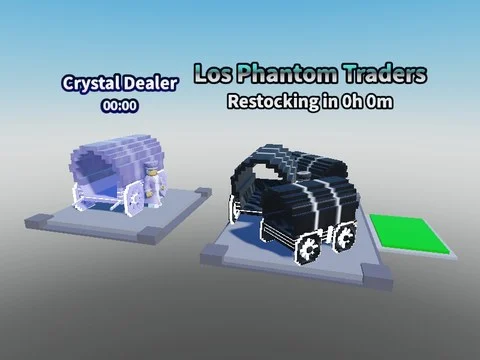

# Phantom Dealer & Crystal Dealer (PNJ marchands)

Deux PNJ marchands : Merchant (Phantom Dealer) et BrainrotTrader (Crystal Dealer), avec 4 scripts.

- **Catégorie** : [Bibliothèque 3D](../Biblioth%C3%A8que%203D.md)
- **Sous-catégorie** : [PNJ & personnages](PNJ%20&%20personnages%20%28Biblioth%C3%A8que%203D%29.md)
- **Type** : Modèle Roblox (.rbxm)
- **Contenu** : 1 fichier · 58 Ko
- **Fichier source** : `Assets/models/ByType/NPC_Characters/Phantom Dealer and Crystal Dealer.rbxm` (dans le vault)
