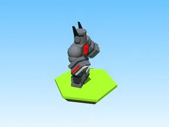

# Robotby Onscurezynkez · Robot Simulator

Modèle en Parts « Robotby Onscurezynkez » (Robot Simulator).

- **Catégorie** : [Bibliothèque 3D](../Biblioth%C3%A8que%203D.md)
- **Sous-catégorie** : [PNJ & personnages](PNJ%20&%20personnages%20%28Biblioth%C3%A8que%203D%29.md)
- **Type** : Modèle en Parts
- **Taille** : 20 × 44 × 40 studs
- **Contenu** : 122 Parts · 2 MeshParts
- **Jeu d'origine** : Robot Simulator
- **Fichier source** : `Assets/models/ByType/NPC_Characters/RobotSim_RobotbyOnscurezynkez.rbxm` (dans le vault)
