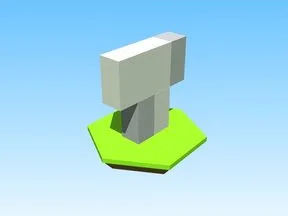

# Stomp · Robot Simulator

Modèle en Parts « Stomp » (Robot Simulator).

- **Catégorie** : [Bibliothèque 3D](../Biblioth%C3%A8que%203D.md)
- **Sous-catégorie** : [PNJ & personnages](PNJ%20%26%20personnages%20%28Biblioth%C3%A8que%203D%29.md)
- **Type** : Modèle en Parts
- **Taille** : 1 × 12 × 18 studs
- **Contenu** : 5 Parts · 1 MeshPart
- **Jeu d'origine** : Robot Simulator
- **Fichier source** : `models/ByType/NPC_Characters/RobotSim_Stomp.rbxm` (dans ta bibliothèque `rblx\lib`)
