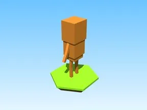

# Tung Tung Sahur · Shoot A Brainrot

Modèle en Parts « Tung Tung Sahur » (Shoot A Brainrot).

- **Catégorie** : [Bibliothèque 3D](../Biblioth%C3%A8que%203D.md)
- **Sous-catégorie** : [PNJ & personnages](PNJ%20&%20personnages%20%28Biblioth%C3%A8que%203D%29.md)
- **Type** : Modèle en Parts
- **Taille** : 1 × 9 × 5 studs
- **Contenu** : 11 Parts · 6 MeshParts
- **Jeu d'origine** : Shoot A Brainrot
- **Fichier source** : `models/ByType/NPC_Characters/ShootABrainrot_TungTungSahur.rbxm` (dans ta bibliothèque `rblx\lib`)
