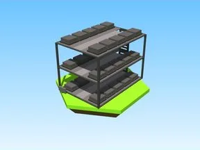

# Modèles Steal an Spooky Egg — compléments (12)

Modèles du jeu Steal an Spooky Egg pas encore dans le vault : CollectionZone, ItemSpawners, Leaderboards, Map, Plots, Rig, Rig_2, Sell, SellNPC, Sounds, SpawnLocation, Speed.

- **Catégorie** : [Bibliothèque 3D](../Biblioth%C3%A8que%203D.md)
- **Sous-catégorie** : [Steal an Spooky Egg](Steal%20an%20Spooky%20Egg%20%28Biblioth%C3%A8que%203D%29.md)
- **Type** : Pack de fichiers
- **Contenu** : 12 fichiers · 0,1 Mo
- **Jeu d'origine** : Steal an Spooky Egg
- **Fichier source** : `Assets/models/SpookyGame` (dans le vault)

## Fichiers (12)

- `CollectionZone.rbxm`
- `ItemSpawners.rbxm`
- `Leaderboards.rbxm`
- `Map.rbxm`
- `Plots.rbxm`
- `Rig.rbxm`
- `Rig_2.rbxm`
- `Sell.rbxm`
- `SellNPC.rbxm`
- `Sounds.rbxm`
- `SpawnLocation.rbxm`
- `Speed.rbxm`
