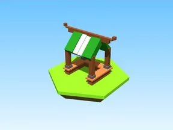

# Stand 2

Modèle en Parts « Stand 2 ».

- **Catégorie** : [Bibliothèque 3D](../Biblioth%C3%A8que%203D.md)
- **Sous-catégorie** : [Steal an Spooky Egg](Steal%20an%20Spooky%20Egg%20%28Biblioth%C3%A8que%203D%29.md)
- **Type** : Modèle en Parts
- **Taille** : 18 × 13 × 8 studs
- **Contenu** : 30 Parts · 2 MeshParts
- **Fichier source** : `Assets/models/SpookyGame/Stand_2.rbxm` (dans le vault)
