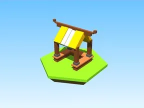

# Steal an Spooky Egg

Sous-catégorie de [Bibliothèque 3D](../Biblioth%C3%A8que%203D.md) · **5 éléments**

| Aperçu | Élément | Infos |
| --- | --- | --- |
|  | [Plot Template](Plot%20Template.md) | Modèle en Parts · 33 × 34 × 49 · 111 Parts |
|  | [Stand](Stand.md) | Modèle en Parts · 18 × 13 × 8 · 30 Parts · 2 MeshParts |
|  | [Stand 2](Stand%202.md) | Modèle en Parts · 18 × 13 × 8 · 30 Parts · 2 MeshParts |
|  | [Stand 3](Stand%203.md) | Modèle en Parts · 18 × 13 × 8 · 30 Parts · 2 MeshParts |
|  | [Modèles Steal an Spooky Egg — compléments (12)](Mod%C3%A8les%20Steal%20an%20Spooky%20Egg%20%E2%80%94%20compl%C3%A9ments%20%2812%29.md) | Pack de fichiers · 12 fichiers · 0,1 Mo |
