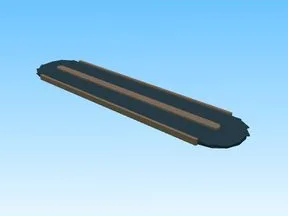

# Conveyor Belt · Bakery Simulator

Modèle en Parts « Conveyor Belt » (Bakery Simulator).

- **Catégorie** : [Bibliothèque 3D](../Biblioth%C3%A8que%203D.md)
- **Sous-catégorie** : [Tycoon & convoyeurs](Tycoon%20&%20convoyeurs%20%28Biblioth%C3%A8que%203D%29.md)
- **Type** : Modèle en Parts
- **Taille** : 91 × 1 × 22 studs
- **Contenu** : 22 Parts · 2 MeshParts
- **Jeu d'origine** : Bakery Simulator
- **Fichier source** : `models/ByType/Conveyors_Tycoon/BakerySim_ConveyorBelt.rbxm` (dans ta bibliothèque `rblx\lib`)
