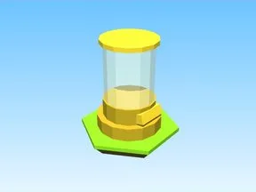

# Tier4 · Magnet Simulator 2

Modèle en Parts « Tier4 » (Magnet Simulator 2).

- **Catégorie** : [Bibliothèque 3D](../Biblioth%C3%A8que%203D.md)
- **Sous-catégorie** : [Œufs & incubateurs](%C5%92ufs%20&%20incubateurs%20%28Biblioth%C3%A8que%203D%29.md)
- **Type** : Modèle en Parts
- **Taille** : 2 × 10 × 1 studs
- **Contenu** : 5 Parts · 16 MeshParts
- **Jeu d'origine** : Magnet Simulator 2
- **Fichier source** : `models/ByType/Eggs_Incubators/MagnetSim2_Tier4.rbxm` (dans ta bibliothèque `rblx\lib`)
