# Œufs & incubateurs

Sous-catégorie de [Bibliothèque 3D](../Biblioth%C3%A8que%203D.md) · **28 éléments**

| Aperçu | Élément | Infos |
| --- | --- | --- |
| 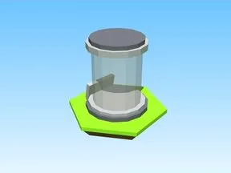 | [Basic · Tapping Lords](Basic%20%C2%B7%20Tapping%20Lords.md) | Modèle en Parts · 3 × 7 × 1 · 7 Parts · 1 MeshPart |
| 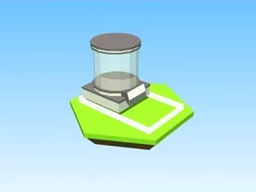 | [Basic Egg 2 · Robot Simulator](Basic%20Egg%202%20%C2%B7%20Robot%20Simulator.md) | Modèle en Parts · 15 × 10 × 9 · 17 Parts · 1 MeshPart |
| 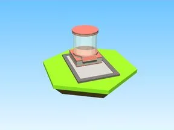 | [Brick Egg 2 · Robot Simulator](Brick%20Egg%202%20%C2%B7%20Robot%20Simulator.md) | Modèle en Parts · 14 × 10 × 9 · 19 Parts · 5 MeshParts |
| 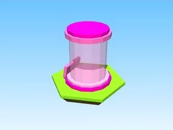 | [Candy · Tapping Lords](Candy%20%C2%B7%20Tapping%20Lords.md) | Modèle en Parts · 3 × 7 × 1 · 7 Parts · 1 MeshPart |
| 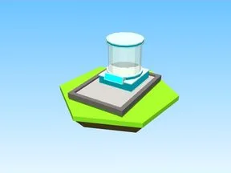 | [Crystal Egg 2 · Robot Simulator](Crystal%20Egg%202%20%C2%B7%20Robot%20Simulator.md) | Modèle en Parts · 12 × 10 × 17 · 19 Parts · 2 MeshParts |
| 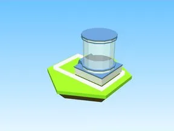 | [Dev Egg 2 · Robot Simulator](Dev%20Egg%202%20%C2%B7%20Robot%20Simulator.md) | Modèle en Parts · 15 × 10 × 9 · 17 Parts · 1 MeshPart |
|  | [Forest · Tapping Lords](Forest%20%C2%B7%20Tapping%20Lords.md) | Modèle en Parts · 3 × 7 × 1 · 5 Parts · 1 MeshPart |
| 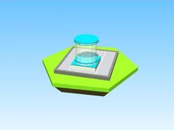 | [Frost Egg 2 · Robot Simulator](Frost%20Egg%202%20%C2%B7%20Robot%20Simulator.md) | Modèle en Parts · 16 × 10 × 17 · 23 Parts · 1 MeshPart |
| 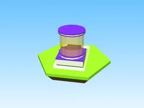 | [Galaxy Egg 2 · Robot Simulator](Galaxy%20Egg%202%20%C2%B7%20Robot%20Simulator.md) | Modèle en Parts · 8 × 10 × 13 · 17 Parts · 1 MeshPart |
| 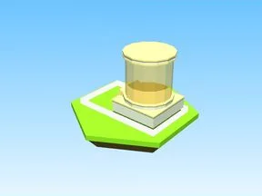 | [Golden Egg 2 · Robot Simulator](Golden%20Egg%202%20%C2%B7%20Robot%20Simulator.md) | Modèle en Parts · 15 × 10 × 9 · 17 Parts · 2 MeshParts |
| 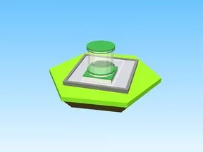 | [Grass Egg 2 · Robot Simulator](Grass%20Egg%202%20%C2%B7%20Robot%20Simulator.md) | Modèle en Parts · 16 × 10 × 17 · 23 Parts · 5 MeshParts |
| 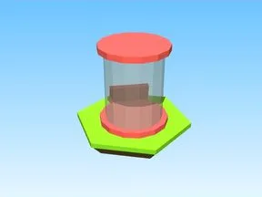 | [Lava · Tapping Lords](Lava%20%C2%B7%20Tapping%20Lords.md) | Modèle en Parts · 2 × 6 × 2 · 5 Parts · 1 MeshPart |
| 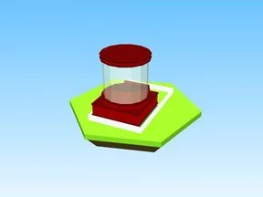 | [Magma Egg 2 · Robot Simulator](Magma%20Egg%202%20%C2%B7%20Robot%20Simulator.md) | Modèle en Parts · 9 × 10 × 14 · 18 Parts · 2 MeshParts |
| 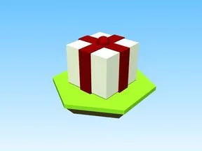 | [Pet Crate Regular · Bakery Simulator](Pet%20Crate%20Regular%20%C2%B7%20Bakery%20Simulator.md) | Modèle en Parts · 1 × 1 × 1 · 4 Parts · 8 MeshParts |
| 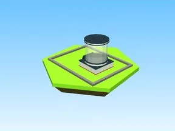 | [Premium Egg 2 · Robot Simulator](Premium%20Egg%202%20%C2%B7%20Robot%20Simulator.md) | Modèle en Parts · 22 × 10 × 17 · 18 Parts · 1 MeshPart |
| 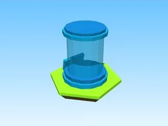 | [Rare · Tapping Lords](Rare%20%C2%B7%20Tapping%20Lords.md) | Modèle en Parts · 3 × 7 × 1 · 7 Parts · 1 MeshPart |
| 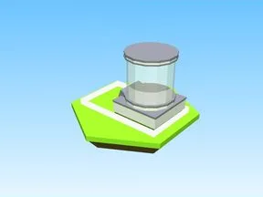 | [Robotic Egg · Robot Simulator](Robotic%20Egg%20%C2%B7%20Robot%20Simulator.md) | Modèle en Parts · 15 × 10 × 9 · 17 Parts · 1 MeshPart |
| 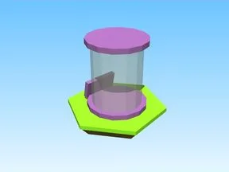 | [Space · Tapping Lords](Space%20%C2%B7%20Tapping%20Lords.md) | Modèle en Parts · 3 × 7 × 1 · 5 Parts · 1 MeshPart |
| 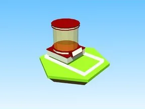 | [Sparkle Egg 2 · Robot Simulator](Sparkle%20Egg%202%20%C2%B7%20Robot%20Simulator.md) | Modèle en Parts · 15 × 10 × 9 · 17 Parts · 1 MeshPart |
| 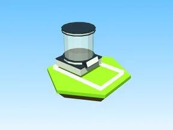 | [Spike Egg 2 · Robot Simulator](Spike%20Egg%202%20%C2%B7%20Robot%20Simulator.md) | Modèle en Parts · 15 × 10 × 9 · 17 Parts · 1 MeshPart |
| 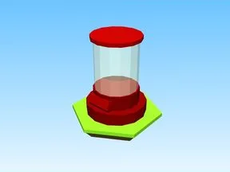 | [Tier1 · Magnet Simulator 2](Tier1%20%C2%B7%20Magnet%20Simulator%202.md) | Modèle en Parts · 1 × 10 × 2 · 5 Parts · 1 MeshPart |
| 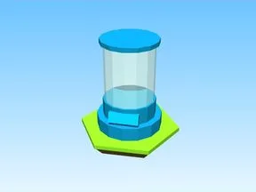 | [Tier2 · Magnet Simulator 2](Tier2%20%C2%B7%20Magnet%20Simulator%202.md) | Modèle en Parts · 1 × 10 × 2 · 5 Parts · 4 MeshParts |
| 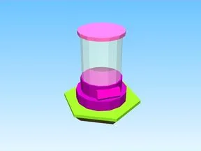 | [Tier3 · Magnet Simulator 2](Tier3%20%C2%B7%20Magnet%20Simulator%202.md) | Modèle en Parts · 2 × 10 × 1 · 5 Parts · 4 MeshParts |
|  | [Tier4 · Magnet Simulator 2](Tier4%20%C2%B7%20Magnet%20Simulator%202.md) | Modèle en Parts · 2 × 10 × 1 · 5 Parts · 16 MeshParts |
| 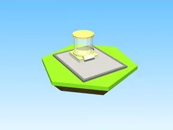 | [Vip Egg 2 · Robot Simulator](Vip%20Egg%202%20%C2%B7%20Robot%20Simulator.md) | Modèle en Parts · 21 × 10 × 17 · 19 Parts · 1 MeshPart |
| 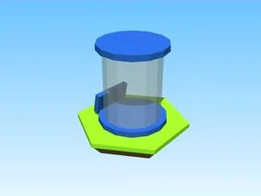 | [Water · Tapping Lords](Water%20%C2%B7%20Tapping%20Lords.md) | Modèle en Parts · 3 × 7 × 1 · 5 Parts · 1 MeshPart |
|  | [Œufs & incubateurs — pack par type (90 modèles)](%C5%92ufs%20&%20incubateurs%20%E2%80%94%20pack%20par%20type%20%2890%20mod%C3%A8les%29.md) | Pack de fichiers · 90 fichiers · 5,2 Mo |
| 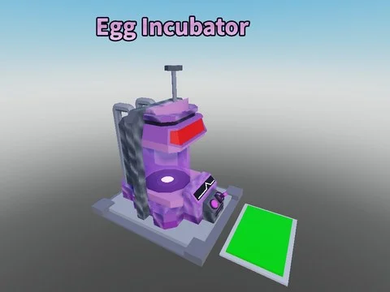 | [Egg Incubator Machine](Egg%20Incubator%20Machine.md) | Modèle Roblox (.rbxm) · 1 fichier · 27 Ko |
