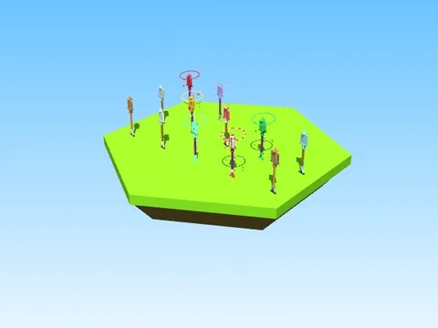

# Pelles v3 (Shovel for Eggs)

12 Tools pelles. Version du jeu au 29/10/2026 (dernière version).

- **Catégorie** : [Bibliothèque 3D](../Biblioth%C3%A8que%203D.md)
- **Sous-catégorie** : [Hiver - Shovel for Eggs](Hiver%20-%20Shovel%20for%20Eggs%20%28Biblioth%C3%A8que%203D%29.md)
- **Fichier** : `Assets/models/ShovelForEggs/v29oct/ShovelForEggs_Shovels.rbxm`
