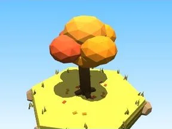
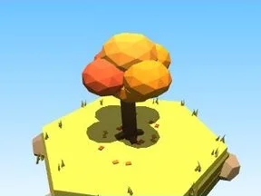
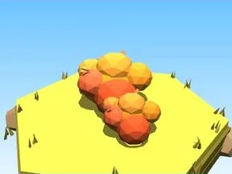
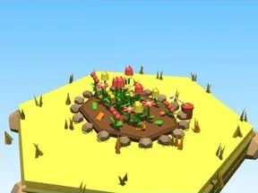
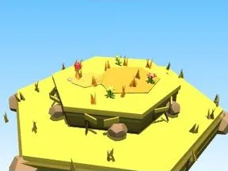
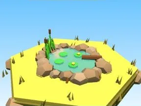
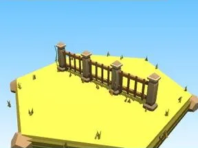
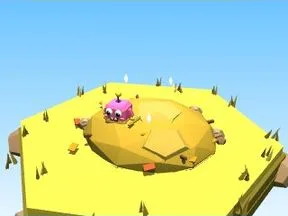
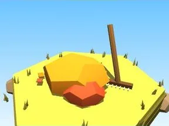
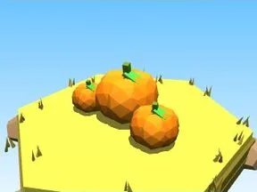

# Automne

Sous-catégorie de [Biomes](../Biomes.md) · **16 éléments**

| Aperçu | Élément | Infos |
| --- | --- | --- |
|  | [Arbre Automne](Arbre%20Automne.md) | Élément de biome · 9 × 11 × 9 |
|  | [Petit arbre Automne](Petit%20arbre%20Automne.md) | Élément de biome · 5 × 6 × 5 |
|  | [Buisson Automne](Buisson%20Automne.md) | Élément de biome · 7 × 3 × 5 |
|  | [Massif de fleurs Automne](Massif%20de%20fleurs%20Automne.md) | Élément de biome · 10 × 4 × 8 |
|  | [Rochers Automne](Rochers%20Automne.md) | Élément de biome · 7 × 4 × 6 |
|  | [Gros rocher Automne](Gros%20rocher%20Automne.md) | Élément de biome · 10 × 8 × 9 |
|  | [Cristaux Automne](Cristaux%20Automne.md) | Élément de biome · 6 × 7 × 6 |
|  | [Bloc de terrain Automne](Bloc%20de%20terrain%20Automne.md) | Élément de biome · 13 × 4 × 12 |
|  | [Étang Automne](%C3%89tang%20Automne.md) | Élément de biome · 12 × 5 × 11 |
|  | [Œuf Automne](%C5%92uf%20Automne.md) | Élément de biome · 5 × 4 × 4 |
|  | [Coffre Automne](Coffre%20Automne.md) | Élément de biome · 5 × 6 × 5 |
|  | [Clôture Automne](Cl%C3%B4ture%20Automne.md) | Élément de biome · 20 × 6 × 2 |
|  | [Portail de zone Automne](Portail%20de%20zone%20Automne.md) | Élément de biome · 18 × 14 × 9 |
|  | [Tas à ratisser Automne](Tas%20%C3%A0%20ratisser%20Automne.md) | Élément de biome · 8 × 4 × 8 |
|  | [Tas de feuilles (Automne)](Tas%20de%20feuilles%20%28Automne%29.md) | Modèle low-poly · 8 × 6 × 7 |
|  | [Citrouilles (Automne)](Citrouilles%20%28Automne%29.md) | Modèle low-poly · 7 × 3 × 4 |
