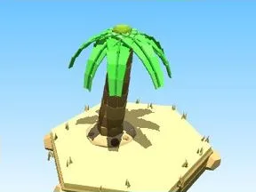
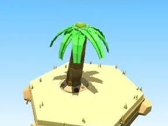
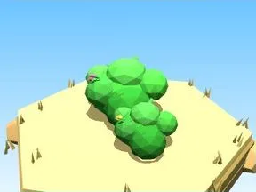
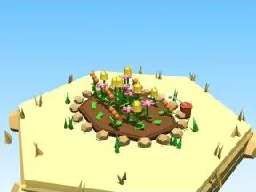
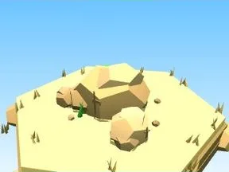
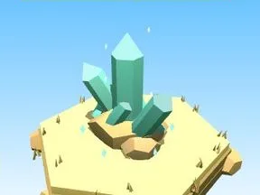
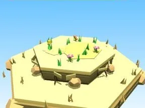
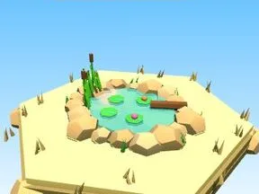
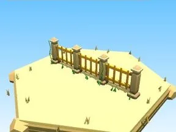
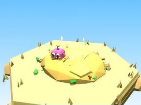

# Beach

Sous-catégorie de [Biomes](../Biomes.md) · **16 éléments**

| Aperçu | Élément | Infos |
| --- | --- | --- |
|  | [Arbre Beach](Arbre%20Beach.md) | Élément de biome · 10 × 9 × 9 |
|  | [Petit arbre Beach](Petit%20arbre%20Beach.md) | Élément de biome · 6 × 6 × 6 |
|  | [Buisson Beach](Buisson%20Beach.md) | Élément de biome · 7 × 3 × 5 |
|  | [Massif de fleurs Beach](Massif%20de%20fleurs%20Beach.md) | Élément de biome · 10 × 4 × 8 |
|  | [Rochers Beach](Rochers%20Beach.md) | Élément de biome · 7 × 4 × 6 |
|  | [Gros rocher Beach](Gros%20rocher%20Beach.md) | Élément de biome · 10 × 8 × 9 |
|  | [Cristaux Beach](Cristaux%20Beach.md) | Élément de biome · 6 × 7 × 6 |
|  | [Bloc de terrain Beach](Bloc%20de%20terrain%20Beach.md) | Élément de biome · 13 × 4 × 12 |
|  | [Étang Beach](%C3%89tang%20Beach.md) | Élément de biome · 12 × 5 × 11 |
|  | [Œuf Beach](%C5%92uf%20Beach.md) | Élément de biome · 5 × 4 × 4 |
|  | [Coffre Beach](Coffre%20Beach.md) | Élément de biome · 7 × 6 × 5 |
|  | [Clôture Beach](Cl%C3%B4ture%20Beach.md) | Élément de biome · 20 × 6 × 2 |
|  | [Portail de zone Beach](Portail%20de%20zone%20Beach.md) | Élément de biome · 18 × 14 × 9 |
|  | [Tas à ratisser Beach](Tas%20%C3%A0%20ratisser%20Beach.md) | Élément de biome · 8 × 4 × 8 |
|  | [Corail (Beach)](Corail%20%28Beach%29.md) | Modèle low-poly · 6 × 5 × 4 |
|  | [Squelette de poisson (Beach)](Squelette%20de%20poisson%20%28Beach%29.md) | Modèle low-poly · 4 × 2 × 10 |
