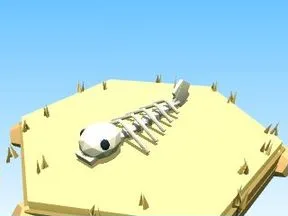

# Squelette de poisson (Beach)

Décor spécial du biome Beach.

- **Catégorie** : [Biomes](../Biomes.md)
- **Sous-catégorie** : [Beach](Beach.md)
- **Type** : Modèle low-poly
- **Taille** : 4 × 2 × 10 studs
