# Candy Land

Sous-catégorie de [Biomes](../Biomes.md) · **16 éléments**

| Aperçu | Élément | Infos |
| --- | --- | --- |
| 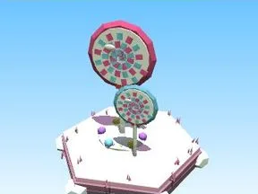 | [Arbre Candy Land](Arbre%20Candy%20Land.md) | Élément de biome · 8 × 11 × 6 |
| 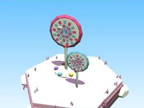 | [Petit arbre Candy Land](Petit%20arbre%20Candy%20Land.md) | Élément de biome · 6 × 7 × 3 |
| 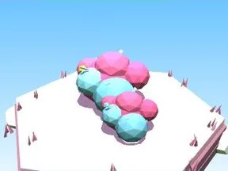 | [Buisson Candy Land](Buisson%20Candy%20Land.md) | Élément de biome · 7 × 3 × 5 |
|  | [Massif de fleurs Candy Land](Massif%20de%20fleurs%20Candy%20Land.md) | Élément de biome · 10 × 4 × 8 |
| 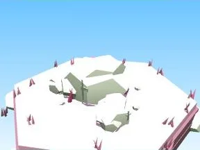 | [Rochers Candy Land](Rochers%20Candy%20Land.md) | Élément de biome · 7 × 4 × 6 |
| 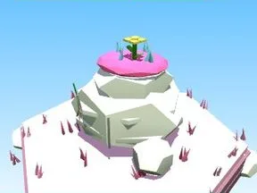 | [Gros rocher Candy Land](Gros%20rocher%20Candy%20Land.md) | Élément de biome · 10 × 8 × 9 |
| 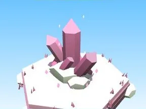 | [Cristaux Candy Land](Cristaux%20Candy%20Land.md) | Élément de biome · 6 × 7 × 6 |
| 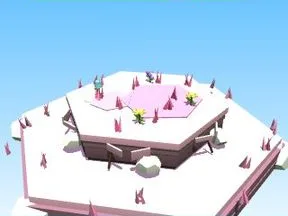 | [Bloc de terrain Candy Land](Bloc%20de%20terrain%20Candy%20Land.md) | Élément de biome · 13 × 4 × 12 |
| 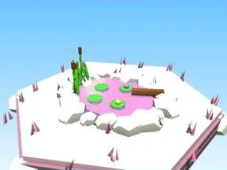 | [Étang Candy Land](%C3%89tang%20Candy%20Land.md) | Élément de biome · 12 × 5 × 11 |
|  | [Œuf Candy Land](%C5%92uf%20Candy%20Land.md) | Élément de biome · 5 × 4 × 4 |
| 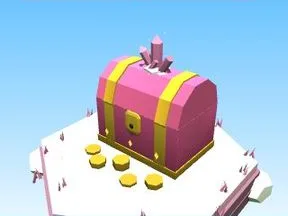 | [Coffre Candy Land](Coffre%20Candy%20Land.md) | Élément de biome · 5 × 6 × 5 |
| 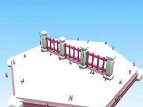 | [Clôture Candy Land](Cl%C3%B4ture%20Candy%20Land.md) | Élément de biome · 20 × 6 × 2 |
| 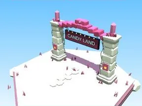 | [Portail de zone Candy Land](Portail%20de%20zone%20Candy%20Land.md) | Élément de biome · 18 × 14 × 9 |
| 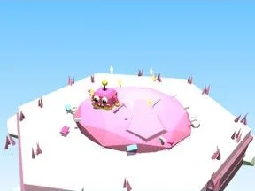 | [Tas à ratisser Candy Land](Tas%20%C3%A0%20ratisser%20Candy%20Land.md) | Élément de biome · 8 × 4 × 8 |
| 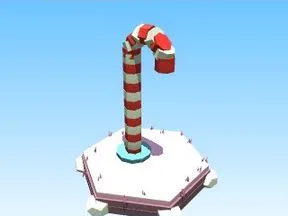 | [Sucre d’orge (Candy Land)](Sucre%20d%E2%80%99orge%20%28Candy%20Land%29.md) | Modèle low-poly · 5 × 12 × 3 |
| 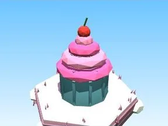 | [Cupcake géant (Candy Land)](Cupcake%20g%C3%A9ant%20%28Candy%20Land%29.md) | Modèle low-poly · 7 × 9 × 7 |
