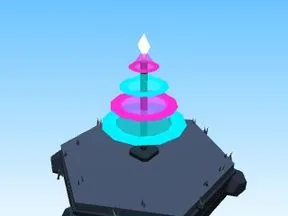

# Petit arbre Cyber City

Version plus petite de l’arbre.

- **Catégorie** : [Biomes](../Biomes.md)
- **Sous-catégorie** : [Cyber City](Cyber%20City.md)
- **Type** : Élément de biome
- **Taille** : 5 × 8 × 5 studs
