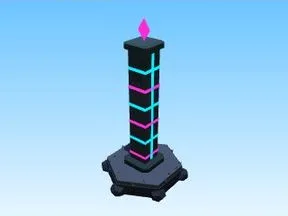

# Pilier néon (Cyber City)

Décor spécial du biome Cyber City.

- **Catégorie** : [Biomes](../Biomes.md)
- **Sous-catégorie** : [Cyber City](Cyber%20City.md)
- **Type** : Modèle low-poly
- **Taille** : 4 × 18 × 4 studs
