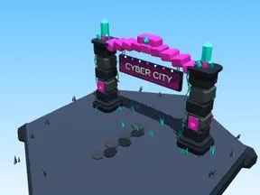

# Portail de zone Cyber City

Entrée de zone avec nom en 3D.

- **Catégorie** : [Biomes](../Biomes.md)
- **Sous-catégorie** : [Cyber City](Cyber%20City.md)
- **Type** : Élément de biome
- **Taille** : 18 × 14 × 9 studs
